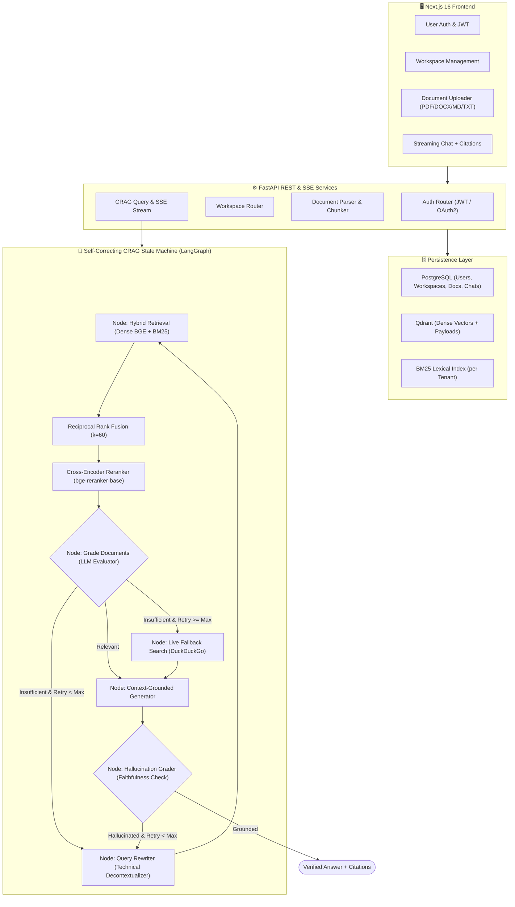

# DocuMind — AI Knowledge Base for Teams (Agentic CRAG)

[](https://nextjs.org/)
[](https://fastapi.tiangolo.com)
[](https://langchain-ai.github.io/langgraph/)
[](https://qdrant.tech/)
[](https://www.postgresql.org/)
[](https://confident-ai.com/)
[](https://opensource.org/licenses/MIT)

**DocuMind** is a production-grade, multi-tenant **AI Knowledge Base platform** powered by a self-correcting **Agentic Corrective Retrieval-Augmented Generation (CRAG)** engine. Teams upload their internal documents (PDF, DOCX, Markdown, TXT) and query them with natural language to receive accurate, cited answers with hallucination detection and automated web search fallback.

---

## Architecture Overview



---

## Key Features

### 1. Full-Stack Web Application
- **Next.js 16 Frontend**: Responsive dashboard with dark mode, workspace management, document upload with real-time processing indicators, and interactive chat interface.
- **FastAPI Async Backend**: Modular routers for Authentication, Workspaces, Documents, Chat Sessions, and CRAG queries.
- **PostgreSQL Persistence**: Complete relational schema for Users, Workspaces, Workspace Memberships, Document metadata, Chat Sessions, and Chat Messages.

### 2. Multi-Format Document Ingestion Pipeline
- **PyMuPDF (`fitz`)**: High-speed PDF text extraction across multi-page documents.
- **`python-docx`**: Full table and paragraph parsing for Microsoft Word documents.
- **Markdown & TXT**: Sanitized HTML stripping and multi-encoding text parsing.
- **Deterministic Recursive Text Chunker**: Overlapping chunker ($size=512, overlap=64$) with idempotent SHA-256 chunk identifiers.

### 3. Multi-Stage Hybrid Retrieval & Cross-Encoder Re-Ranking
- **Dense Vector Search**: Powered by `BAAI/bge-small-en-v1.5` embeddings (384 dimensions) indexed in **Qdrant** with Cosine distance and sub-millisecond payload filtering on `tenant_id`.
- **Sparse Lexical Search**: In-memory **BM25Okapi** scoring for exact keyword matching, technical identifiers, and error codes.
- **Reciprocal Rank Fusion (RRF)**: Merges rank positions from both dense and sparse retrieval stages using $RRF(d) = \sum \frac{1}{k + r_i}$ ($k=60$).
- **Cross-Encoder Re-Ranking**: Scores candidates with `BAAI/bge-reranker-base` and applies Sigmoid normalization to retain only top-$N$ highest-confidence context passages.

### 4. Self-Correcting LangGraph State Machine
- **Document Relevance Grader**: Evaluates retrieved chunks via structured JSON outputs (`yes`/`no`) to discard irrelevant noise before context injection.
- **Decontextualizing Query Rewriter**: When context is insufficient or retrieval misses, the query is rewritten into technical keywords, terminology, and error phrases.
- **Hallucination Grader**: Post-generation verification validates that generated statements are strictly grounded in retrieved evidence.
- **Live Web Search Fallback**: Automatically triggers live DuckDuckGo web search when internal workspace documents lack the required information.

### 5. Multi-Tenant Data Isolation
- Strict workspace isolation using deterministic SHA-256 chunk identifiers and Qdrant indexed payload filter fields (`tenant_id`), guaranteeing zero cross-tenant data leakage.

### 6. Automated CI/CD Evaluation Gate (DeepEval)
- Integrated test suite (`tests/test_eval_pipeline.py`) running in GitHub Actions with a local Qdrant container service.
- Evaluates test cases against a golden dataset checking **Faithfulness** ($\ge 0.70$) and **Answer Relevancy** ($\ge 0.70$).

---

## Project Structure

```plaintext
Agentic_CRAG/
├── frontend/                          # Next.js 16 Web Application
│   ├── src/
│   │   ├── app/                       # App Router (Pages & Layouts)
│   │   │   ├── page.tsx               # Landing page with feature showcase
│   │   │   ├── layout.tsx             # Root layout with AuthProvider & Navbar
│   │   │   ├── login/page.tsx         # User authentication login
│   │   │   ├── register/page.tsx      # User registration
│   │   │   └── dashboard/             # Workspace & Document dashboard
│   │   │       ├── page.tsx           # Workspace list & creation
│   │   │       └── [workspaceId]/     # Workspace documents & upload
│   │   │           └── chat/page.tsx  # Interactive chat with sessions & citations
│   │   ├── components/                # Reusable UI components
│   │   │   ├── Navbar.tsx             # Navigation header
│   │   │   ├── ChatMessage.tsx        # Message bubble with citation cards
│   │   │   ├── ChatInput.tsx          # Multi-line input with auto-resize
│   │   │   ├── DocumentUpload.tsx     # Drag & drop upload with progress
│   │   │   └── SessionSidebar.tsx     # Chat history session manager
│   │   └── lib/                       # Utilities & API client
│   │       ├── api.ts                 # Full API client with token management
│   │       └── auth.tsx               # React Auth Context & hooks
│   ├── package.json
│   └── tsconfig.json
│
├── src/                               # FastAPI Backend Application
│   ├── api/                           # API Layer
│   │   ├── main.py                    # App entry point, lifespan, & router registration
│   │   ├── dependencies.py            # OAuth2 & JWT dependency injection
│   │   ├── schemas.py                 # Pydantic request & response models
│   │   └── routers/                   # Modular API routers
│   │       ├── auth.py                # Register, login, & /me endpoints
│   │       ├── workspaces.py          # Workspace & member management CRUD
│   │       ├── documents.py           # Document upload, listing, & deletion
│   │       ├── chat.py                # Chat sessions & message persistence
│   │       └── query.py               # CRAG query & SSE streaming endpoints
│   ├── db/                            # Relational Database Layer
│   │   ├── database.py                # SQLAlchemy 2.0 engine, SessionLocal, & get_db
│   │   └── models.py                  # ORM Models (User, Workspace, Member, Doc, Chat)
│   ├── services/                      # Business Logic Services
│   │   ├── auth_service.py            # Password hashing & JWT generation
│   │   ├── workspace_service.py       # Workspace CRUD & slug generation
│   │   ├── chat_service.py            # Session & message persistence
│   │   └── document_service.py        # Parse, chunk, & index pipeline
│   ├── parsers/                       # Document Extraction & Chunking
│   │   ├── pdf_parser.py              # PyMuPDF PDF extraction
│   │   ├── docx_parser.py             # python-docx extraction
│   │   ├── markdown_parser.py         # Markdown cleaning & extraction
│   │   ├── txt_parser.py              # Multi-encoding text parsing
│   │   └── chunker.py                 # RecursiveCharacterTextSplitter with SHA-256 IDs
│   ├── graph/                         # Agentic CRAG State Machine (LangGraph)
│   │   ├── nodes.py                   # Node functions (retrieve, grade, rewrite, fallback, generate)
│   │   ├── schemas.py                 # Pydantic grading schemas
│   │   ├── state.py                   # TypedDict GraphState definition
│   │   └── workflow.py                # LangGraph StateGraph conditional routing & compilation
│   ├── retrieval/                     # Retrieval & Re-Ranking
│   │   ├── reranker.py                # Cross-encoder joint scoring with Sigmoid calibration
│   │   └── vector_store.py            # HybridRetriever (Qdrant dense + BM25 sparse + RRF)
│   ├── config.py                      # Pydantic BaseSettings configuration
│   └── models.py                      # Core domain schemas
│
├── tests/
│   ├── golden_dataset.json            # Curated ground-truth QA evaluation pairs
│   └── test_eval_pipeline.py          # DeepEval test suite (Faithfulness & Answer Relevancy)
├── benchmark.py                       # Retrieval benchmark (Dense vs BM25 vs RRF vs Re-ranked)
├── test_crag_graph.py                 # End-to-end CRAG state machine test
├── docker-compose.yml                 # Local dev: Qdrant + PostgreSQL
├── docker-compose.prod.yml            # Production: Full stack (Backend + Qdrant + PostgreSQL)
├── Dockerfile                         # Backend container configuration
├── requirements.txt                   # Pinned Python dependencies
├── .env.example                       # Backend environment template
└── README.md
```

---

## Tech Stack

| Layer | Technology | Purpose |
|---|---|---|
| **Frontend** | [Next.js 16](https://nextjs.org/) + React 19 + TypeScript | Full-stack web application with App Router |
| **Styling** | [Tailwind CSS](https://tailwindcss.com/) | Responsive dark-mode user interface |
| **Backend API** | [FastAPI](https://fastapi.tiangolo.com/) + Uvicorn | Async REST API & Server-Sent Events (SSE) streaming |
| **State Machine** | [LangGraph](https://github.com/langchain-ai/langgraph) / LangChain | Cyclic agentic graph, self-correcting loops, & conditional routing |
| **LLM Inference** | [Groq](https://groq.com/) (`ChatGroq`) | Ultra-fast inference with structured tool calling |
| **Vector Database** | [Qdrant](https://qdrant.tech/) | Vector storage, payload filtering & HNSW indexing |
| **Relational Database** | [PostgreSQL 16](https://www.postgresql.org/) + SQLAlchemy 2.0 | Users, Workspaces, Documents, Chat sessions & Message history |
| **Embeddings** | `BAAI/bge-small-en-v1.5` | Dense semantic sentence embeddings (384 dims) |
| **Lexical Search** | `rank-bm25` (BM25Okapi) | Exact term & keyword search |
| **Re-Ranking** | `BAAI/bge-reranker-base` | Cross-encoder contextual relevance re-ranking |
| **Doc Parsers** | PyMuPDF, python-docx, markdown | Parsing PDF, DOCX, Markdown, and TXT files |
| **Evaluation Gate** | [DeepEval](https://github.com/confident-ai/deepeval) + `pytest` | Automated LLM evaluation (Faithfulness, Relevancy) |
| **Infrastructure** | Docker & Docker Compose | Containerized database and microservice deployment |

---

## Getting Started

### 1. Prerequisites
- **Python 3.11+**
- **Node.js 18+ & npm**
- **Docker & Docker Compose**
- **Groq API Key** (free from [console.groq.com](https://console.groq.com))

---

### 2. Backend Setup

```bash
# Clone the repository
git clone https://github.com/Sq1754/Agentic_CRAG.git
cd Agentic_CRAG

# Create and activate a virtual environment
python -m venv venv
# On Windows:
.\venv\Scripts\activate
# On Linux/macOS:
source venv/bin/activate

# Install Python dependencies
pip install -r requirements.txt

# Configure environment variables
cp .env.example .env
# Edit .env and add your GROQ_API_KEY
```

#### Start Local Databases (Qdrant & PostgreSQL):
```bash
docker-compose up -d
```

Verify services:
- Qdrant Web UI: `http://localhost:6333/dashboard`
- PostgreSQL: `localhost:5432` (`documind` / `documind_dev`)

#### Start the FastAPI Server:
```bash
uvicorn src.api.main:app --host 0.0.0.0 --port 8000 --reload
```

Interactive OpenAPI Swagger documentation will be available at:
👉 **`http://localhost:8000/docs`**

---

### 3. Frontend Setup

In a new terminal window:

```bash
cd frontend

# Install Node dependencies
npm install

# Start the Next.js development server
npm run dev
```

Open your browser to:
👉 **`http://localhost:3000`**

1. Register an account at `http://localhost:3000/register`.
2. Create a workspace on the dashboard.
3. Upload PDF, DOCX, Markdown, or TXT documents.
4. Click **Open Chat** and start asking questions with verified citations and self-correcting AI!

---

## Production Deployment

### Option A: Railway (Backend + DBs) + Vercel (Frontend)

1. **Backend & Databases on Railway**:
   - Create a new project on [Railway](https://railway.app/).
   - Add a **PostgreSQL** service and a **Qdrant** service (`qdrant/qdrant:v1.11.3`).
   - Deploy the backend using the root `Dockerfile`.
   - Set environment variables (`DATABASE_URL`, `QDRANT_HOST`, `GROQ_API_KEY`, `JWT_SECRET_KEY`, `CORS_ORIGINS`).

2. **Frontend on Vercel**:
   - Import your GitHub repo on [Vercel](https://vercel.com/).
   - Set the Root Directory to `frontend`.
   - Add Environment Variable: `NEXT_PUBLIC_API_URL=https://your-backend.up.railway.app`.
   - Deploy.

### Option B: All-in-One Docker Compose (Production Server)

```bash
# Set your production environment variables in .env
docker-compose -f docker-compose.prod.yml up -d --build
```

---

## API Endpoints Reference

### Authentication (`/api/v1/auth`)
| Method | Endpoint | Description |
|---|---|---|
| `POST` | `/api/v1/auth/register` | Register a new user |
| `POST` | `/api/v1/auth/login` | Login and obtain JWT access token |
| `GET` | `/api/v1/auth/me` | Fetch authenticated user profile |

### Workspaces (`/api/v1/workspaces`)
| Method | Endpoint | Description |
|---|---|---|
| `POST` | `/api/v1/workspaces/` | Create a new workspace (creator is admin) |
| `GET` | `/api/v1/workspaces/` | List workspaces user belongs to |
| `GET` | `/api/v1/workspaces/{id}` | Get workspace details |
| `POST` | `/api/v1/workspaces/{id}/members` | Add member to workspace (admin only) |
| `DELETE` | `/api/v1/workspaces/{id}/members/{uid}` | Remove member from workspace |
| `DELETE` | `/api/v1/workspaces/{id}` | Delete workspace (owner only) |

### Documents (`/api/v1/workspaces/{id}/documents`)
| Method | Endpoint | Description |
|---|---|---|
| `POST` | `/api/v1/workspaces/{id}/documents/upload` | Upload & index file (PDF, DOCX, MD, TXT) |
| `GET` | `/api/v1/workspaces/{id}/documents/` | List indexed documents in workspace |
| `GET` | `/api/v1/workspaces/{id}/documents/{docId}` | Get document metadata & chunk count |
| `DELETE` | `/api/v1/workspaces/{id}/documents/{docId}` | Delete document and storage file |

### Chat & Queries (`/api/v1/workspaces/{id}`)
| Method | Endpoint | Description |
|---|---|---|
| `POST` | `/api/v1/workspaces/{id}/chat/sessions` | Create a new chat session |
| `GET` | `/api/v1/workspaces/{id}/chat/sessions` | List user's chat sessions in workspace |
| `GET` | `/api/v1/workspaces/{id}/chat/sessions/{sid}/messages` | Get message history for session |
| `DELETE` | `/api/v1/workspaces/{id}/chat/sessions/{sid}` | Delete session and its messages |
| `POST` | `/api/v1/workspaces/{id}/query` | Execute CRAG query (stores to session) |
| `GET` | `/api/v1/workspaces/{id}/query/stream` | Stream CRAG execution steps via SSE |

---

## Automated CI/CD Evaluation Gate (DeepEval)

Every pull request runs automated tests in `.github/workflows/eval-gate.yml` against ground-truth evaluation pairs (`tests/golden_dataset.json`):

```bash
python -m pytest tests/test_eval_pipeline.py -v
```

- **Faithfulness ($\ge 0.70$)**: Verifies answer claims are strictly grounded in retrieved evidence.
- **Answer Relevancy ($\ge 0.70$)**: Verifies response satisfies the user's inquiry directly.

---

## License

This project is licensed under the MIT License - see the LICENSE file for details.
