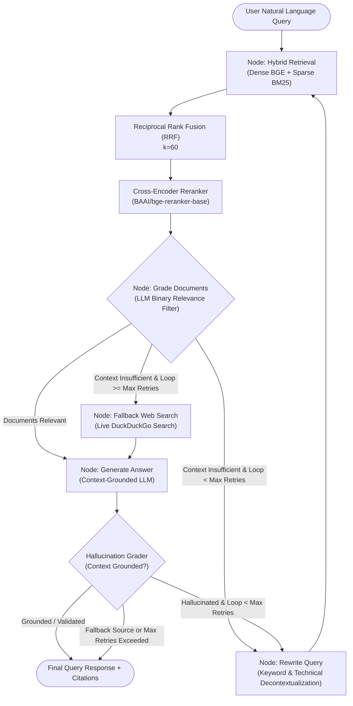

# Agentic Corrective RAG (CRAG) Engine

[](https://www.python.org/)
[](https://fastapi.tiangolo.com)
[](https://langchain-ai.github.io/langgraph/)
[](https://qdrant.tech/)
[](https://confident-ai.com/)
[](https://opensource.org/licenses/MIT)

A production-grade, self-correcting **Agentic Corrective Retrieval-Augmented Generation (CRAG)** service. This system overcomes the fundamental limitations of naive RAG—such as retrieval noise, hallucinated answers, and out-of-domain query failures—by combining **hybrid search (BM25 + Dense vector search)**, **cross-encoder re-ranking**, and a **cyclic LangGraph state machine** featuring automated document grading, query rewriting, groundedness checks, and real-time web search fallback.

---

## Architecture Overview



---

## Key Features

### 1. Multi-Stage Hybrid Retrieval with Reciprocal Rank Fusion (RRF)
- **Dense Vector Search**: Powered by `BAAI/bge-small-en-v1.5` embeddings (384-dim) indexed in **Qdrant** with Cosine similarity.
- **Sparse Lexical Search**: In-memory **BM25Okapi** scoring for exact keyword matching, technical identifiers, and error codes.
- **Reciprocal Rank Fusion (RRF)**: Merges rank positions from both dense and sparse retrieval stages using $RRF(d) = \sum \frac{1}{k + r_i}$ ($k=60$) to neutralize score distribution differences.

### 2. Cross-Encoder Precision Re-Ranking
- Applies `BAAI/bge-reranker-base` across all candidate pairs to evaluate cross-attention between query and chunk.
- Maps raw logits to calibrated probabilities $[0, 1]$ via sigmoid normalization: $S = \frac{1}{1 + e^{-z}}$, retaining only top-$N$ highest-confidence context passages.

### 3. Agentic Self-Correction Loop (LangGraph State Machine)
- **Document Relevance Grader**: Evaluates each retrieved document chunk via structured JSON schemas (`yes`/`no`) to discard irrelevant noise before context injection.
- **Decontextualizing Query Rewriter**: When context is insufficient or retrieval misses, the query is rewritten into technical keywords, terminology, and error phrases.
- **Hallucination Grader**: Post-generation verification validates that generated statements are strictly grounded in retrieved evidence.
- **Retry Budget Control**: Configurable loop limit (`max_retries`, default: 2) prevents infinite loops and guarantees latency ceilings.

### 4. Dynamic Live Web Search Fallback
- If the internal tenant corpus lacks the required knowledge after retry attempts, the agent automatically executes an external web search using DuckDuckGo (`ddgs`) to synthesize fresh, accurate answers without failing.

### 5. Multi-Tenant Data Isolation
- Enforces strict tenant segregation using deterministic SHA-256 chunk identifiers (`tenant_id_content`) and Qdrant indexed payload filter fields (`tenant_id`), guaranteeing sub-millisecond tenant-isolated vector filtering.

### 6. Production FastAPI Service & SSE Streaming
- **REST Endpoints**: Complete endpoints for asynchronous batch ingestion, synchronous querying with latency tracing and structured citations.
- **Server-Sent Events (SSE)**: Live streaming endpoint (`/api/v1/query/stream`) streaming real-time node transitions, query rewrites, and token generations to frontends.

### 7. Automated CI/CD Evaluation Quality Gate (DeepEval)
- Integrated test suite (`tests/test_eval_pipeline.py`) running in GitHub Actions with a local Qdrant container service.
- Evaluates test cases against a golden dataset checking **Faithfulness** ($\ge 0.70$) and **Answer Relevancy** ($\ge 0.70$) with rate-limit backoff handling.

---

## Directory Structure

```plaintext
Agentic_CRAG/
├── .github/
│   └── workflows/
│       └── eval-gate.yml          # GitHub Actions CI/CD automated evaluation gate
├── src/
│   ├── api/
│   │   ├── main.py                # FastAPI app, lifespan setup, REST & SSE endpoints
│   │   └── schemas.py             # Pydantic request/response schemas & citations
│   ├── graph/
│   │   ├── nodes.py               # Node functions (retrieve, grade, rewrite, fallback, generate)
│   │   ├── schemas.py             # Pydantic grading schemas (DocumentRelevance, HallucinationGrade)
│   │   ├── state.py               # TypedDict GraphState definition
│   │   └── workflow.py            # LangGraph StateGraph conditional routing & compilation
│   ├── retrieval/
│   │   ├── reranker.py            # Cross-encoder joint scoring with Sigmoid calibration
│   │   └── vector_store.py        # HybridRetriever (Qdrant dense + BM25 sparse + RRF)
│   ├── config.py                  # Pydantic BaseSettings configuration
│   └── models.py                  # Domain models (DocumentChunk, SearchResult)
├── tests/
│   ├── golden_dataset.json        # Curated ground-truth QA evaluation pairs
│   └── test_eval_pipeline.py      # DeepEval test suite (Faithfulness & Answer Relevancy)
├── benchmark.py                   # Retrieval benchmark (Dense vs BM25 vs RRF vs Re-ranked)
├── test_crag_graph.py             # End-to-end CRAG state machine test (In-domain & Fallback)
├── docker-compose.yml             # Qdrant vector database container configuration
├── requirements.txt               # Pinned project dependencies
├── .env.example                   # Environment configuration template
└── README.md                      # Documentation
```

---

## Tech Stack

| Component | Technology | Purpose |
|---|---|---|
| **Graph Orchestration** | [LangGraph](https://github.com/langchain-ai/langgraph) / LangChain | Cyclic state machine, conditional routing & self-correction |
| **LLM Inference** | [Groq](https://groq.com/) (`ChatGroq`) | Ultra-fast inference with structured tool calling |
| **Vector Database** | [Qdrant](https://qdrant.tech/) | Vector storage, payload filtering & HNSW indexing |
| **Dense Embeddings** | `BAAI/bge-small-en-v1.5` | Dense semantic sentence embeddings (384 dims) |
| **Sparse Retrieval** | `rank-bm25` (BM25Okapi) | Exact term & keyword search |
| **Re-Ranking** | `BAAI/bge-reranker-base` | Cross-encoder contextual relevance re-ranking |
| **External Search** | `ddgs` (DuckDuckGo Search) | Live web search fallback mechanism |
| **Web API** | [FastAPI](https://fastapi.tiangolo.com/) + `uvicorn` | High-performance async REST & SSE streaming |
| **Streaming** | `sse-starlette` | Real-time Server-Sent Events (SSE) |
| **Evaluation Gate** | [DeepEval](https://github.com/confident-ai/deepeval) + `pytest` | Automated LLM evaluation (Faithfulness, Relevancy) |
| **Infrastructure** | Docker & Docker Compose | Containerized local Qdrant deployment |

---

## Getting Started

### 1. Prerequisites
- **Python 3.11+**
- **Docker & Docker Compose** (for running Qdrant)
- **Groq API Key** (free from [console.groq.com](https://console.groq.com))

### 2. Clone and Install Dependencies

```bash
git clone https://github.com/Sq1754/Agentic_CRAG.git
cd Agentic_CRAG

# Create and activate a virtual environment
python -m venv venv
# On Windows:
.\venv\Scripts\activate
# On Linux/macOS:
source venv/bin/activate

# Install dependencies
pip install -r requirements.txt
```

### 3. Configure Environment Variables

Create a `.env` file in the project root:

```env
GROQ_API_KEY=your_groq_api_key_here
GROQ_MODEL=openai/gpt-oss-20b
QDRANT_HOST=localhost
QDRANT_PORT=6333
QDRANT_COLLECTION=tenant_corpus
DENSE_MODEL=BAAI/bge-small-en-v1.5
RERANKER_MODEL=BAAI/bge-reranker-base
```

### 4. Start Qdrant Vector Store

```bash
docker-compose up -d
```

Verify that Qdrant is running:
- Web Dashboard: `http://localhost:6333/dashboard`
- Health check: `http://localhost:6333/healthz`

---

## Running Benchmarks & Pipeline Tests

### Hybrid Retrieval & Reranker Benchmark
Compare dense search, sparse BM25, Reciprocal Rank Fusion, and cross-encoder re-ranking:

```bash
python benchmark.py
```

### End-to-End CRAG Graph Test
Runs both an **in-domain** query (direct retrieval + answer) and an **out-of-domain** query (triggers rewriting loop and falls back to live web search):

```bash
python test_crag_graph.py
```

---

## Starting the API Server

Start the FastAPI application with Uvicorn:

```bash
uvicorn src.api.main:app --host 0.0.0.0 --port 8000 --reload
```

Interactive OpenAPI Swagger documentation will be available at:
👉 **`http://localhost:8000/docs`**

---

## API Endpoints

### 1. Ingest Documents (`POST /api/v1/documents/index`)
Indexes raw documents into the tenant's isolated vector and BM25 index.

**Request:**
```bash
curl -X POST "http://localhost:8000/api/v1/documents/index" \
     -H "Content-Type: application/json" \
     -d '{
       "tenant_id": "team_infra",
       "documents": [
         "PgBouncer is configured in transaction mode with pool size of 20 per database user.",
         "Max client connections are capped at 5000 to prevent database socket exhaustion."
       ],
       "metadata": {"source": "architecture_docs"}
     }'
```

**Response:**
```json
{
  "status": "success",
  "tenant_id": "team_infra",
  "chunks_indexed": 2
}
```

---

### 2. Execute Query (`POST /api/v1/query`)
Runs the full CRAG agentic pipeline with automatic document grading, rewriting, fallback, and hallucination evaluation.

**Request:**
```bash
curl -X POST "http://localhost:8000/api/v1/query" \
     -H "Content-Type: application/json" \
     -d '{
       "tenant_id": "team_infra",
       "query": "What is the connection pool size per user?",
       "max_retries": 2
     }'
```

**Response:**
```json
{
  "answer": "The connection pool size is 20 per database user as configured in PgBouncer.",
  "query": "What is the connection pool size per user?",
  "rewritten_query": null,
  "relevance_status": "relevant",
  "loop_count": 0,
  "citations": [
    {
      "chunk_id": "8f42d13b4802c61f",
      "source": "cross_encoder",
      "score": 0.9412,
      "preview": "PgBouncer is configured in transaction mode with pool size of 20 per database user."
    }
  ],
  "latency_ms": 312.45
}
```

---

### 3. Stream Query Execution (`GET /api/v1/query/stream`)
Receives real-time Server-Sent Events (SSE) as each graph node executes:

```bash
curl -N "http://localhost:8000/api/v1/query/stream?tenant_id=team_infra&query=What+causes+ERR_SOCKET_TIMEOUT&max_retries=2"
```

**SSE Event Stream Output:**
```json
data: {"node": "retrieve", "relevance_status": null, "loop_count": null, "rewritten_query": null, "generation": null}
data: {"node": "grade_documents", "relevance_status": "insufficient", "loop_count": null, "rewritten_query": null, "generation": null}
data: {"node": "rewrite_query", "relevance_status": null, "loop_count": 1, "rewritten_query": "Envoy proxy ERR_SOCKET_TIMEOUT timeout upstream HTTP connection", "generation": null}
data: {"node": "retrieve", "relevance_status": null, "loop_count": null, "rewritten_query": null, "generation": null}
data: {"node": "grade_documents", "relevance_status": "relevant", "loop_count": null, "rewritten_query": null, "generation": null}
data: {"node": "generate", "relevance_status": null, "loop_count": null, "rewritten_query": null, "generation": "ERR_SOCKET_TIMEOUT occurs when an upstream HTTP connection exceeds 30000ms in Envoy Proxy."}
```

---

## Automated CI/CD Evaluation Gate (DeepEval)

This repository includes an automated evaluation gate in `.github/workflows/eval-gate.yml`. Every PR and push executes end-to-end tests evaluating pipeline responses against a ground-truth dataset (`tests/golden_dataset.json`).

### Running Locally:

```bash
python -m pytest tests/test_eval_pipeline.py -v
```

### Metrics Evaluated:
1. **Faithfulness ($\ge 0.70$)**: Assesses whether the model's answer is mathematically grounded in retrieved context without fabricating unsupported assertions.
2. **Answer Relevancy ($\ge 0.70$)**: Assesses whether the model's answer directly and concisely satisfies the user's intent.

---

## License

This project is licensed under the MIT License - see the LICENSE file for details.
